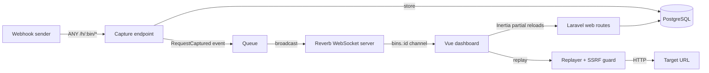

# Catchhook

**Inspect webhooks in real time.** Catchhook gives you a unique URL that captures every HTTP request sent to it. Requests appear in your browser the moment they arrive, and you can inspect, search, diff and replay them.

Built with **Laravel 13**, **Vue 3 + TypeScript**, **Inertia**, **Laravel Reverb** (WebSockets) and **PostgreSQL**.

## Features

- **Capture anything.** Any method, any sub-path, any content type. Bodies are stored byte-for-byte, binary payloads included.
- **Live dashboard.** New requests stream in over WebSockets. If the connection drops, the dashboard re-syncs when it reconnects, so nothing is missed.
- **Inspect.** Headers, query parameters, and bodies with JSON pretty-printing, form-field tables and hex dumps for binary data.
- **Replay.** Re-send any request to another URL, as-is or with an edited method, headers or body, and see the target's response.
- **Custom responses.** Choose the status, headers, body and an artificial delay the bin answers with, to test how senders handle errors, timeouts and retries.
- **Search and diff.** Search paths, headers and bodies server-side, filter by method, and compare two requests side by side.
- **Copy as code.** Reproduce any request as cURL, JavaScript `fetch` or Python `requests`.

## Quick start

With Docker:

```bash
git clone https://github.com/hrahman11/catchhook.git
cd catchhook
docker compose up --build
```

Open <http://localhost:8000>, create a bin, then send it a request:

```bash
curl -X POST "http://localhost:8000/h/<your-bin-id>/orders?source=cli" \
  -H "Content-Type: application/json" \
  -d '{"event":"order.paid","id":42}'
```

This starts the web server, the Reverb WebSocket server, a queue worker, the scheduler and PostgreSQL. To use another port, set `APP_PORT=8090`. Compose also reads a `.env` file next to `compose.yaml`, so values such as `APP_KEY` and `REVERB_APP_KEY` set there override the local-only defaults.

<details>
<summary>Without Docker</summary>

Requires PHP 8.4, Composer, Node 24 and PostgreSQL.

```bash
composer install && npm install
cp .env.example .env && php artisan key:generate
php artisan reverb:install   # generates REVERB_* credentials
php artisan migrate
composer dev                 # web server, Vite, Reverb and queue worker
```

</details>

## Architecture



A captured request is stored, then broadcast through the queue, so the sender gets its response without waiting for the WebSocket server. The broadcast carries a short summary, and the dashboard fetches headers and body only when you open a request.

## Design decisions

**Capture routes run outside the `web` middleware group.** Senders never get sessions, cookies or CSRF checks. Rate limiting and the body-size check run _before_ the bin is loaded, so floods and requests to unknown bins never reach the database.

**Bodies are stored losslessly.** Valid UTF-8 is stored as text, which keeps it readable and searchable. Anything else is base64-encoded, so binary payloads round-trip byte-for-byte. Bodies are read with `getContent()`, so Laravel's input trimming never touches them.

**WebSockets via Reverb, not SSE.** Server-Sent Events would hold a PHP worker open for every connected dashboard. Reverb is an event-driven server built for long-lived connections, and Laravel's broadcasting gives a clean event-to-channel model.

**Replay is protected against SSRF.** Replays are sent from the server, so targets must use http(s) and **every** DNS record must be a public address: no loopback, private ranges, link-local addresses (including cloud metadata at `169.254.169.254`) or IPv4-mapped IPv6. The connection is pinned to the validated IP to defeat DNS rebinding, and redirects are never followed. See [`TargetGuard`](app/Services/Replay/TargetGuard.php).

**Custom responses can't attack the app.** A bin can return any HTML from the app's own origin. To keep that safe, every capture response is served with `Content-Security-Policy: sandbox` and `nosniff`, and `Set-Cookie` and security headers can't be overridden. See [`SecureHookResponse`](app/Http/Middleware/SecureHookResponse.php).

**Numbers are never rounded.** `JSON.parse` rounds integers beyond 2^53, which corrupts large IDs. Pretty-printing re-indents the source text instead of re-serializing it, and code snippets embed bodies verbatim, so signed payloads still verify.

**Search without a full-text index.** Bins keep their 500 most recent requests, so a case-insensitive substring scan over a single bin, found through the `bin_id` index, is fast and needs no extra infrastructure.

**Diffs use Myers' algorithm,** the one behind `git diff`. JSON bodies are pretty-printed first, so changes line up field by field.

## Quality

|                 |                                                                                                                    |
| --------------- | ------------------------------------------------------------------------------------------------------------------ |
| PHP tests       | Pest, run against PostgreSQL: `composer test`                                                                      |
| Frontend tests  | Vitest: `npm test`                                                                                                 |
| Static analysis | Larastan at **max level**, no baseline: `composer analyse`                                                         |
| Code style      | Pint, ESLint and Prettier: `composer lint`, `npm run lint`, `npm run format:check`                                 |
| CI              | GitHub Actions runs all of the above, plus type checking and a production build, against a real PostgreSQL service |

## Configuration

| Variable                                | Default | Description                                                                                |
| --------------------------------------- | ------- | ------------------------------------------------------------------------------------------ |
| `CATCHHOOK_BIN_TTL_DAYS`                | `7`     | How long a bin stays active before it's pruned                                             |
| `CATCHHOOK_MAX_BODY_KB`                 | `512`   | Largest request body a bin accepts                                                         |
| `CATCHHOOK_MAX_REQUESTS_PER_BIN`        | `500`   | Older requests are discarded beyond this                                                   |
| `CATCHHOOK_CAPTURES_PER_MINUTE_PER_BIN` | `120`   | Rate limit per bin                                                                         |
| `CATCHHOOK_CAPTURES_PER_MINUTE_PER_IP`  | `300`   | Rate limit per client across all bins                                                      |
| `CATCHHOOK_MAX_RESPONSE_DELAY_MS`       | `10000` | Longest artificial delay for custom responses                                              |
| `CATCHHOOK_REPLAY_TIMEOUT`              | `10`    | Replay timeout in seconds                                                                  |
| `CATCHHOOK_REPLAY_ALLOW_PRIVATE`        | `false` | Allow replays to localhost and private networks. **Enable only on self-hosted instances.** |

Expired bins are pruned hourly by the scheduler (`php artisan schedule:work`, or a cron entry running `schedule:run`).

## License

[MIT](LICENSE)
